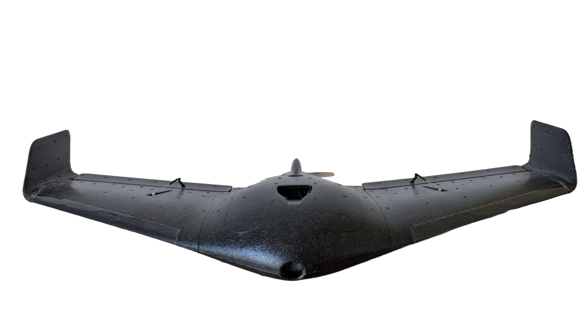
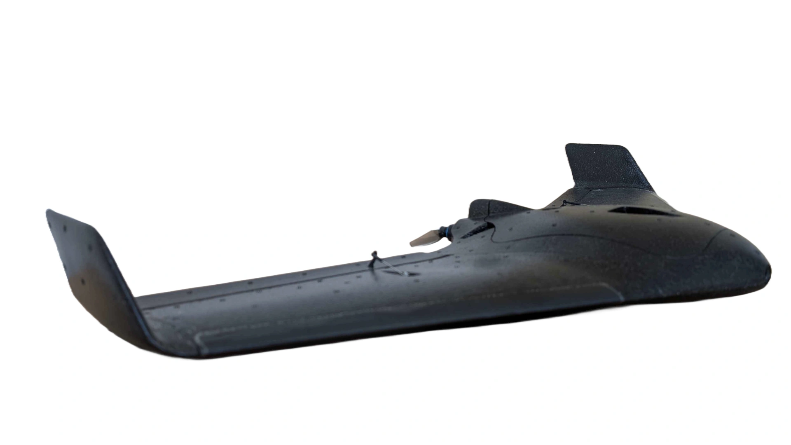
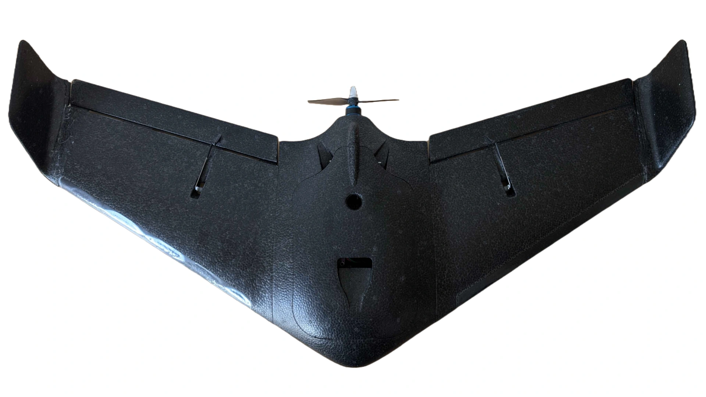
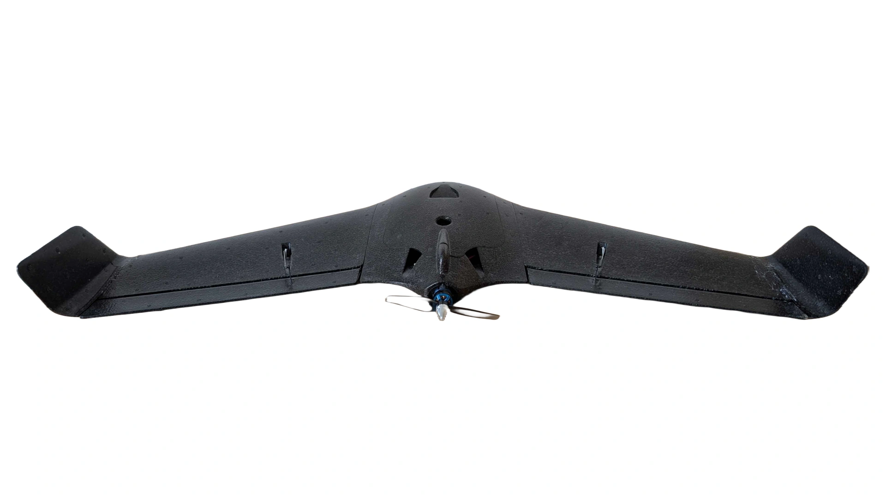
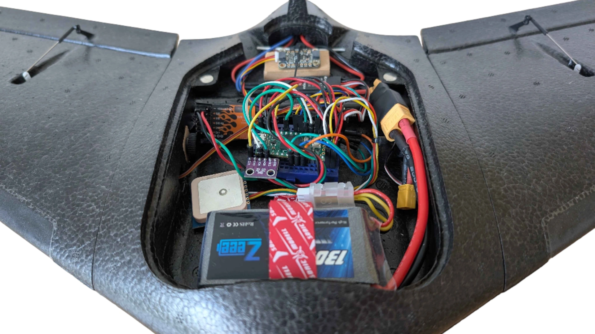
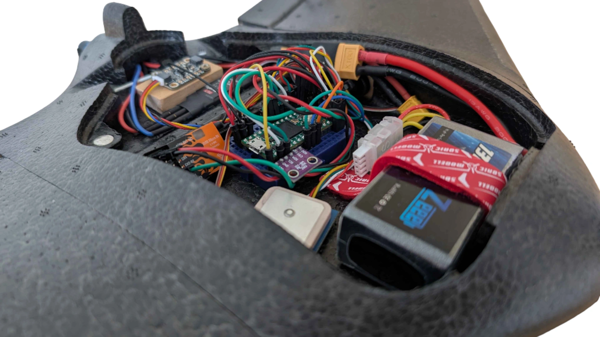
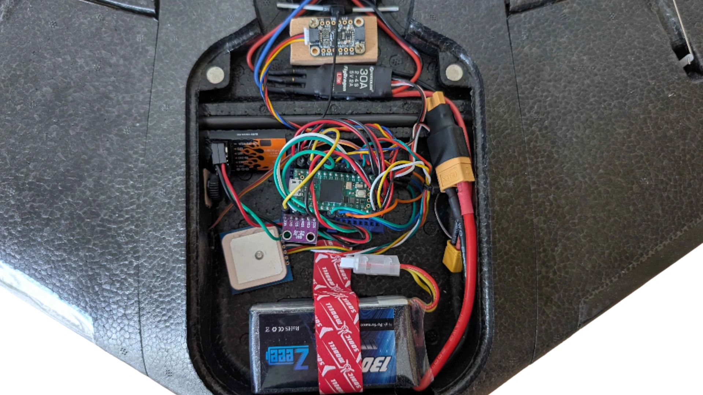

# Wing
This project deals with the complete automation of remote-controlled aircraft. On the one hand, complex and sophisticated algorithms assist the pilot in flying and try to neutralize safety risks.

On the other hand, these systems are used to fully automate the operation of these aircraft, making pilot intervention unnecessary. In the process, functionalities of already existing systems are extended and improved.

The project aims to enable anyone to control such an aircraft and to make it easy to automate processes that are currently operated manually.

## Status

|        | Build Status                                                                |
|--------|-----------------------------------------------------------------------------|
| master |  |

## Motivation
Personally, I have been involved in aviation and aircraft control for years. In doing so, I have dealt with the physical and technical side. So I could collect deep knowledge in this area.
Furthermore, I have been involved in software development for years. So I have participated in many projects and implemented many own ideas.

On this basis I created this project. It combines and unites both sides in this work. This is especially fun for me, because I can now try out theoretical process in the real world. A really extraordinary project!

## Development
Development is currently taking place on the [Teensy 4.0](https://www.pjrc.com/store/teensy40.html) board. It has an ARM Cortex-M7 processor, 2 GB flash and 1 GB RAM.

Previously, I used an [Arduino Nano](https://docs.arduino.cc/hardware/nano) to develop the project. However, after some time, I reached the performance limit of the board. Especially 32KB Flash size was not enough anymore. Therefore I changed to the Teensy 4.0. This board is simply much more powerful than the Arduino Nano, but it costs a bit more. I personally can recommend the Teensy!

## Evaluation
To test the functionality of my systems, I use remote-controlled aircraft. Personally, I prefer small planes as they are easier to transport. However, you don't have a lot of space to work with inside. But that has never been a problem for me. Furthermore, small aircraft have certain legal advantages.

I am currently using the [ZOHD Talon 250G](https://www.zohd.net/talon-250g). A great plane! It has great aerodynamic properties and is great fun to fly. There isn't much space inside, but it's enough for my equipment.

***Images of the aircraft will be uploaded in the future***

I have owned other airplanes in the past. For example, the [Sonicmodell Baby AR Wing Pro](https://de.banggood.com/Sonicmodell-Baby-AR-Wing-Pro-682mm-Wingspan-EPP-FPV-Flying-Wing-RC-Airplane-KIT-or-PNP-p-1989357.html?cur_warehouse=USA&ID=46057522804). Also a great plane, however it unfortunately crashed some time ago and broke as a result :( I also had some planes from Flite Test. The [FT Goblin](https://store.flitetest.com/ft-goblin-wr-760mm/), the [FT Alpha](https://store.flitetest.com/ft-alpha-mkr2/) or the [FT Tiny Trainer](https://store.flitetest.com/ft-mighty-mini-tiny-trainer-mkr2/). These airplanes could not convince me rather. They are simply much less resistant than airplanes made of EPP material. On the other hand, airplanes made of this material usually cost a bit more.

## Goals
The biggest goal of the project is that anyone can fly a remote-controlled aircraft using this software. For this I have developed various aids and security mechanisms.

Another goal is to create a development environment to give other people the opportunity to expand the software or implement their own functionalities. You should be able to use a type of module to give certain commands to the aircraft and add your own algorithms in small code sections.

## Aircraft

## License

[GPL](https://github.com/LukasBreuerDE/cast/blob/master/LICENSE.md)